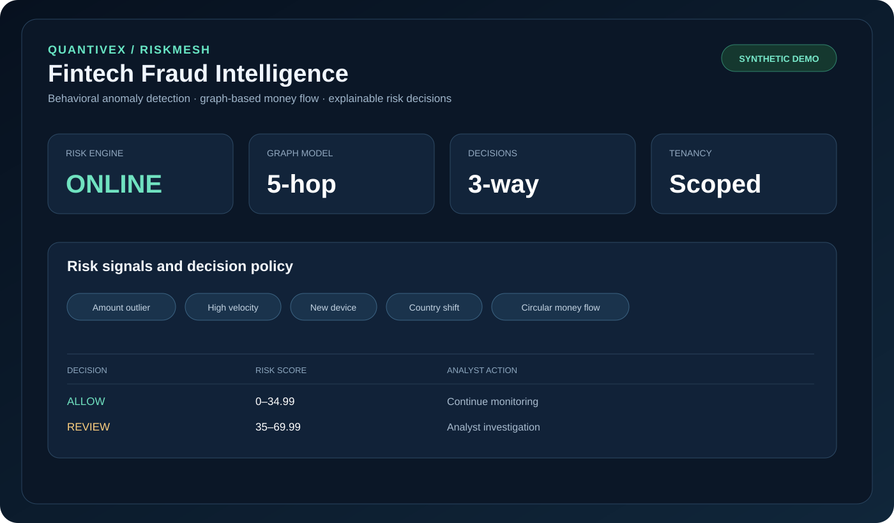
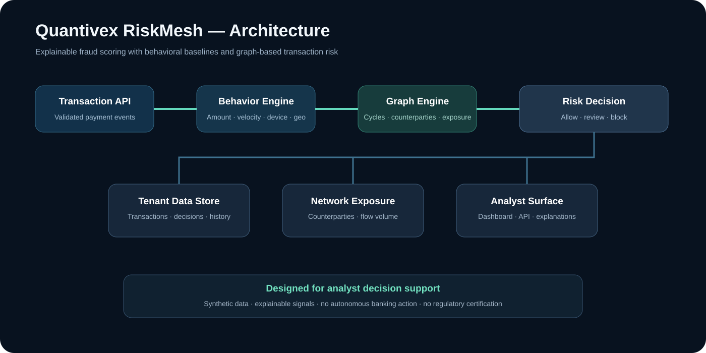

# Quantivex RiskMesh



## Executive summary
**Quantivex RiskMesh** is an advanced fintech fraud-detection and transaction-monitoring prototype that combines behavioral anomaly detection with graph-based money-flow analytics. It scores transactions using explainable signals, detects short circular transfer paths, tracks network exposure, persists tenant-scoped decisions, and exposes both API and dashboard surfaces for analyst review.

The project is designed to demonstrate fintech engineering, fraud analytics, graph algorithms, backend/API development, multi-tenant data handling, containerization, and automated CI in one portfolio application.

## Architecture



## Advanced security and graph intelligence

The advanced engine combines **time-respecting graph traversal** with detection of circular funding, aggregation/layering and rapid dispersal. It applies nonlinear risk fusion to reduce naive double-counting of correlated signals. Every advanced investigation returns a **canonical HMAC-SHA256 signed decision envelope** that can be independently verified against tampering.

These are implemented algorithms—not a claimed proprietary breakthrough or a trained ML model. The signed envelopes prove integrity only to parties with the shared signing key; they are not nonrepudiable public-key signatures. For production use, migrate to KMS-managed asymmetric signatures and signed tenant identities.

**Advanced API:** `POST /api/v1/advanced/investigate` and `POST /api/v1/advanced/verify`. Set `RISK_MESH_SIGNING_KEY` to a separate random secret of at least 32 characters. All advanced endpoints require the existing API key.

## Implemented capabilities
- Behavioral amount-outlier detection using account-specific historical baselines.
- Ten-minute transaction-velocity analysis.
- New-device and country-shift signals.
- Directed graph analysis for short circular money-flow patterns.
- Counterparty and gross-flow network exposure scoring.
- Explainable 0–100 risk scores with **allow / review / block** decisions.
- Tenant-scoped SQLite transaction and decision persistence.
- Single-transaction and batch scoring APIs.
- Dockerized dashboard and GitHub Actions testing.

## Quick start

```bash
git clone https://github.com/samadalam481470sa-cmd/quantivex-riskmatch-FRAUD-DEYECTION-.git
cd quantivex-riskmatch-FRAUD-DEYECTION-
docker compose up --build
```

Open:
- Dashboard: `http://localhost:8000`
- API documentation: `http://localhost:8000/docs`

For authenticated scoring:

```bash
export RISK_MESH_API_KEY='replace-with-a-strong-random-secret'
curl -X POST http://localhost:8000/api/v1/score \
  -H "X-API-Key: $RISK_MESH_API_KEY" \
  -H "Content-Type: application/json" \
  -d '{
    "transaction_id":"demo-001",
    "timestamp":"2026-10-29T18:00:00Z",
    "tenant_id":"portfolio",
    "sender_account":"acct-a",
    "receiver_account":"acct-b",
    "amount":25000,
    "currency":"USD",
    "device_id":"device-1",
    "source_ip":"192.0.2.10",
    "country":"US",
    "channel":"web"
  }'
```

## API surface
- `GET /health` — health check.
- `POST /api/v1/score` — score and persist one transaction.
- `POST /api/v1/batch` — sequentially score a bounded batch.
- `GET /api/v1/decisions` — tenant-scoped recent risk decisions.
- `GET /api/v1/exposure/{account}` — graph exposure summary.
- `GET /` — visual dashboard.

## Risk model
The current model is deliberately explainable. Each decision is the sum of transparent risk signals rather than an opaque production ML model. Signals include amount deviation, transaction velocity, device novelty, country novelty, and directed graph cycles. Scores at or above 35 are routed for review; scores at or above 70 produce a prototype block decision.

## Security and limitations
This repository uses synthetic/example data and is **not connected to real banking rails**. The current API-key mode and caller-provided tenant identifier are suitable only for local demonstration. It does not establish production-grade identity, regulatory compliance, AML/KYC effectiveness, sanctions screening, or fraud-loss performance.

Before any real financial deployment, add signed OIDC identity, server-derived tenant authorization, production database isolation, encrypted secrets, gateway/WAF controls, model calibration on representative authorized data, drift monitoring, transaction idempotency, immutable audit records, sanctions/AML integration as legally appropriate, backup/recovery exercises, penetration testing, and formal compliance/security review.

## Roadmap
- [x] Explainable behavioral fraud signals
- [x] Graph cycle and network exposure analytics
- [x] Tenant-scoped transaction and decision persistence
- [x] Dashboard, Docker, automated tests and CI
- [ ] Signed OIDC multi-tenant RBAC
- [ ] PostgreSQL and production migration framework
- [ ] Streaming event ingestion and durable outbox
- [ ] Model calibration, drift and performance monitoring
- [ ] Case management and investigator workflow
- [ ] Independent security and financial-model validation

> **Portfolio disclaimer:** risk decisions in this repository are demonstrations for analyst decision support. They must not be used to deny, freeze, or move real customer funds.
