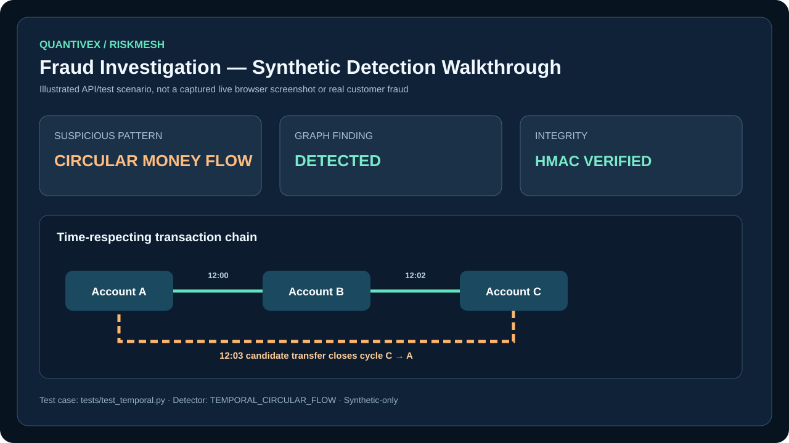

# Quantivex RiskMesh
### Explainable Fintech Fraud Intelligence · Temporal Graph Security · Trainable Machine Learning


**Status:** working, CI-tested **research/portfolio prototype** using synthetic data. **Not** a bank, payment processor, real-time fraud guarantee, or certified compliance product.

Quantivex RiskMesh is a Python/FastAPI fintech security platform that combines behavioral anomaly detection, temporal graph algorithms, a trainable logistic-regression fraud classifier, cryptographically authenticated risk reports, and opt-in public threat-indicator ingestion. It is designed to explain *why* a transaction appears suspicious, show how accounts are connected, and provide analysts with reproducible evidence rather than relying on opaque scores alone.

The repository contains executable application code, automated tests, a responsive dashboard, a reproducible synthetic ML model artifact, Docker configuration, CI workflows, and a documented demonstration of fraud-pattern detection.

## Live interactive showcase

This repository now includes a deployable **FastAPI fraud investigation console**
for recruiters. Unlike the earlier static dashboard illustration, it calls the
actual Python scoring and temporal-graph detection functions. Choose from four
fixed synthetic cases, run an investigation, inspect the risk score, explainable
signals and timestamp-ordered fund-flow evidence.

**Deployment boundary:** Vercel hosts only the read-only synthetic showcase.
The `app.py` entrypoint disables all credential-protected transaction APIs.
The local/container development application remains available separately.
The project is **not independently certified or ready for real customer money**.

See [Hosted demo deployment and verification](docs/HOSTED_DEMO_DEPLOYMENT.md).

## Screenshots and demonstrations

### 1. Application dashboard


**Image type:** designed dashboard preview of the implemented web UI; not a captured production environment. The actual HTML dashboard is served at `GET /` and can be opened locally.

### 2. Synthetic fraud caught by the temporal graph engine



**Image type:** illustrated synthetic test walkthrough, **not** a live browser screenshot or real customer transaction. It corresponds to the deterministic circular-funding detection test in `tests/test_temporal.py`:

```text
12:00  A → B   transaction a
12:02  B → C   transaction b
12:03  C → A   transaction c (candidate)

Finding: TEMPORAL_CIRCULAR_FLOW
Evidence: ["a", "b", "c"]
Reason: candidate closes a time-ordered funding cycle
```

To independently verify this scenario, run `pytest -q tests/test_temporal.py`. The code checks timestamps and tenant boundaries rather than merely searching a static graph.

### 3. System architecture


## What the platform actually does

| Capability | Implementation | What it detects or returns |
| --- | --- | --- |
| Amount anomaly detection | `engine.py` | High-value new profiles and large deviations from historical account amounts |
| Transaction velocity | `engine.py` | Many transfers by the same sender within ten minutes |
| Device novelty | `engine.py` | A device not previously associated with the sending account |
| Geographic novelty | `engine.py` | A new country relative to the sender's history |
| Static transaction graph | `engine.py` | Directed cycles and counterparty exposure |
| Time-respecting graph search | `temporal.py` | Multi-hop circular funding with chronological constraints |
| Aggregation/layering motif | `temporal.py` | Multiple sources funding an intermediary before a comparable outbound payment |
| Rapid dispersal motif | `temporal.py` | A sender rapidly distributing money to multiple recipients |
| Nonlinear risk fusion | `temporal.py` | Combines behavioral and graph evidence into a bounded risk score |
| Trainable fraud ML | `learning.py` | Regularized logistic regression with seven historical features |
| Model interpretability | `learning.py` | Per-feature log-odds contributions |
| Chronological evaluation | `learning.py` | Holdout precision, recall, false-positive rate, Brier score, confusion matrix |
| Signed model artifacts | `learning.py` | HMAC-SHA256 integrity verification for JSON model parameters |
| Signed investigation reports | `attestation.py` | Canonical HMAC-SHA256 envelopes and tamper verification |
| Public threat indicators | `intelligence.py` | Normalized IP and domain indicators from approved HTTPS JSON feeds |
| Tenant-scoped storage | `store.py` | Local SQLite transaction and risk-decision records |
| Analyst API | `api.py` | Single/batch scoring, exposure analysis, ML shadow inference, graph investigations |
| Visual dashboard | `dashboard.html` | Responsive risk-engine overview and signal explanations |
| Deployment/testing | Docker + GitHub Actions | Lint, unit/API tests, Docker build and HTTP smoke tests |

## Security measures implemented — exact inventory

The following describes **code that exists**, not hypothetical protections.

### Authentication and API access
1. **API key authentication** for scoring, decisions, exposure, ML inference, graph investigation, and signature verification endpoints.
2. **Constant-time API-key comparison** using `secrets.compare_digest` to reduce timing-information leakage.
3. **Fail-closed configuration**: authenticated endpoints return HTTP 503 when the API key is unset or shorter than the configured minimum of 24 characters.
4. **Separated signing secrets**: decision attestations use `RISK_MESH_SIGNING_KEY`; ML model artifacts use `RISK_MESH_MODEL_KEY`, separate from `RISK_MESH_API_KEY`.
5. **Public endpoints limited to the synthetic/demo dashboard and health check**; private API operations require the configured key.

**Boundary:** this is a *single shared-key local demonstration*. Caller-provided tenant identifiers are **not cryptographically tied to user identity**. Do not interpret tenant filtering as production-grade tenant authorization. OIDC/JWT, per-user RBAC, secrets management, and gateway controls remain outstanding.

### Input validation and resource limits
6. **Pydantic transaction schemas** enforce nonempty identifiers, transaction types, currency/country format, positive amounts, and maximum field lengths.
7. **Bounded batch ingestion** caps a single batch at 5,000 transactions.
8. **Bounded graph history** rejects more than 20,000 transactions for relevant analyses.
9. **Graph traversal controls** constrain hop depth and analysis time windows.
10. **Bounded API query parameters** constrain recent-decision limits.
11. **Finite-number checks** reject nonfinite ML training features and malformed model parameters.
12. **Training-data size and class checks** require sufficient labeled examples from both fraud and nonfraud classes.
13. **Threat feed document limits** cap JSON payload size and indicator count.
14. **Threat indicator normalization** validates IP addresses and domain shapes before using them.

### Cryptographic integrity and safe ML loading
15. **HMAC-SHA256 decision attestations** detect unauthorized changes to a signed risk-report payload when the verification secret is protected.
16. **Canonical JSON serialization** stabilizes the byte representation used for signatures.
17. **Constant-time signature comparison** using `hmac.compare_digest`.
18. **HMAC-authenticated ML artifacts** reject altered model bodies before loading.
19. **JSON-only model format** avoids unsafe executable Python pickle deserialization.
20. **Model schema/feature checks** reject incompatible feature lists, nonfinite parameters, and invalid scales.
21. **Atomic replacement** when writing a trained model via a temporary file and `os.replace`.

**Boundary:** HMAC proves integrity to a party holding the shared secret, not third-party nonrepudiation. The committed **synthetic demo model** uses a **public demo key**, so its signature is reproducibility evidence only—not a security boundary.

### Fraud-specific security engineering
22. **Historical tenant filtering inside the scoring engine**, reducing accidental cross-tenant feature mixing.
23. **Time-safe ML feature construction** excludes future transactions and the candidate transaction from historical features.
24. **Chronological training/test split** evaluates on later events instead of randomly mixing past and future.
25. **Time-respecting graph traversal** rejects impossible backward-in-time payment paths.
26. **Explainable findings** include rule codes, risk weights, account relationships, transaction IDs, and reasons.
27. **Nonlinear score fusion** bounds combined behavioral and graph evidence between 0 and 100.
28. **ML shadow mode** reports probabilities and explanations without taking autonomous payment actions.
29. **Prototype risk decisions** use allow/review/block labels but do not connect to real bank payment execution.
30. **Synthetic-only demonstrations and tests** avoid exposing real customer financial records.

### Public threat intelligence ingestion safeguards
31. **Explicit HTTPS hostname allowlist** configured through `RISK_MESH_FEED_HOSTS`.
32. **No automatic redirects** when retrieving approved feeds.
33. **Proxy use disabled** in the feed retrieval helper.
34. **URL credential and unexpected-port rejection**.
35. **HTTP timeout and maximum response-size enforcement**.
36. **No competitor-site scraping, private-site crawling, or unauthorized access**.

**Boundary:** a hostname allowlist alone is not full SSRF protection against DNS rebinding. Production ingestion requires restricted network egress, DNS pinning or an egress proxy, source validation, licensing review, and monitoring.

### Runtime and CI
37. **Nonroot Docker runtime** using a dedicated unprivileged UID.
38. **Read-only container filesystem** in Compose, with a separate temporary writable area.
39. **No-new-privileges container security option**.
40. **Loopback-only host port binding** in Compose by default.
41. **Automated lint, API/unit testing, and container smoke testing** in GitHub Actions.
42. **Synthetic regression tests** for temporal cycles, tenant filtering, fraud motifs, model tampering, data leakage, and unapproved feed URLs.

## Mathematical and engineering foundations

### 1. Behavioral amount anomaly

For a sender with historical transaction mean `μ` and standard deviation `σ`:

```text
z_amount = (amount - μ) / max(σ, fallback_deviation)
```

The current rule raises an `AMOUNT_OUTLIER` finding when the deviation exceeds a threshold and sufficient history exists. Sparse-history high-value transactions use a separate rule.

### 2. Temporal graph fraud

Represent transactions as directed time-stamped edges:

```text
e_i = (sender_i, receiver_i, amount_i, time_i)
```

The temporal engine searches for paths whose transfer timestamps are nondecreasing:

```text
t_1 ≤ t_2 ≤ ... ≤ t_k < or = candidate_time
```

A candidate closing a directed path back to the original account produces `TEMPORAL_CIRCULAR_FLOW`. The engine also evaluates fan-in and fan-out structures that can be consistent with aggregation or dispersal.

### 3. Nonlinear risk fusion

Given a base score `B` and graph finding weights `g_i`, the implemented fusion is:

```text
survival = (1 - clamp(B, 0, 100) / 100) × product(exp(-g_i / 100))
risk = 100 × (1 - survival)
```

This bounds the result, but it is a heuristic—not a statistically calibrated posterior fraud probability.

### 4. Trainable ML model

Seven engineered features:
- Log transaction amount
- One-hour sender activity count
- Sender amount relative to historical median
- New-device indicator
- New-country indicator
- Twenty-four-hour receiver inbound degree
- Night-activity indicator

Standardization and prediction:

```text
z_j = (x_j - mean_j) / scale_j
P(fraud | x) = 1 / (1 + exp(-(bias + sum(weight_j × z_j))))
```

The model is fitted with gradient descent minimizing logistic loss plus L2 regularization. The inference endpoint returns a probability and signed *feature contribution explanations*, not a regulatory determination or payment-blocking command.

### 5. Model quality metrics

The training pipeline computes:
- Precision = TP / (TP + FP)
- Recall = TP / (TP + FN)
- False-positive rate = FP / (FP + TN)
- Brier score = mean((predicted_probability - observed_label)²)

These metrics must be computed on representative held-out labeled data before making any operational performance claim.

## Committed fraud ML model

The repository includes a **real trained model artifact**, not just a class definition:

| File | Purpose |
| --- | --- |
| [`models/synthetic-demo-model.json`](models/synthetic-demo-model.json) | Trained weights, bias, feature means/scales, and public-demo HMAC signature |
| [`models/synthetic-demo-metrics.json`](models/synthetic-demo-metrics.json) | Synthetic chronological holdout results |
| [`scripts/build_demo_model.py`](scripts/build_demo_model.py) | Reproducible deterministic training dataset and model-generation script |
| [`scripts/train_model.py`](scripts/train_model.py) | Train on a supplied authorized labeled JSONL dataset |
| [`src/riskmesh/learning.py`](src/riskmesh/learning.py) | Training, feature engineering, inference, evaluation, signing and loading |
| [`tests/test_demo_model.py`](tests/test_demo_model.py) | Verify the committed artifact matches retraining |

**Synthetic model demonstration:** 160 deliberately generated records, first 120 used for training and last 40 for chronological holdout. The stored synthetic holdout reports 8 true positives, 32 true negatives, 0 false positives, 0 false negatives and a Brier score of approximately 0.00534. **These are results on a deliberately simple synthetic dataset, not evidence of real-world fraud accuracy.** The synthetic fraud labels are strongly correlated with features by construction.

Reproduce the public demo model:

```bash
python -m pip install -e ".[dev]"
python scripts/build_demo_model.py
pytest -q tests/test_demo_model.py tests/test_learning.py
```

The demo key is intentionally public: `PUBLIC-DEMO-ONLY-NOT-A-SECRET-KEY-2026`. **Never use it in a real environment.** For local demo inference only:

```bash
export RISK_MESH_API_KEY="$(python -c 'import secrets; print(secrets.token_urlsafe(32))')"
export RISK_MESH_MODEL_KEY="PUBLIC-DEMO-ONLY-NOT-A-SECRET-KEY-2026"
export RISK_MESH_MODEL_PATH="models/synthetic-demo-model.json"
uvicorn riskmesh.api:app --reload
```

On Windows PowerShell, set the equivalent environment variables with `$env:RISK_MESH_API_KEY`, `$env:RISK_MESH_MODEL_KEY`, and `$env:RISK_MESH_MODEL_PATH`.

## Installation and running the platform

```bash
git clone https://github.com/samadalam481470sa-cmd/quantivex-riskmatch-FRAUD-DEYECTION-.git
cd quantivex-riskmatch-FRAUD-DEYECTION-
python -m venv .venv
source .venv/bin/activate
python -m pip install -e ".[dev]"
export RISK_MESH_API_KEY="$(python -c 'import secrets; print(secrets.token_urlsafe(32))')"
uvicorn riskmesh.api:app --host 127.0.0.1 --port 8000
```

For Docker: `docker compose up --build`. The Compose service binds to `127.0.0.1:8000`. Set API and signing secrets explicitly for authenticated operations. The default SQLite path is under `/tmp` and **does not provide durable production persistence** in the provided Compose setup.

- Dashboard: http://127.0.0.1:8000/
- API documentation: http://127.0.0.1:8000/docs
- Health: http://127.0.0.1:8000/health

## API reference

| Method | Path | Function | Security |
| --- | --- | --- | --- |
| GET | `/` | Responsive demo dashboard | Public demo |
| GET | `/health` | Health and mode | Public |
| POST | `/api/v1/score` | Behavioral/graph risk score and persistence | API key |
| POST | `/api/v1/batch` | Score bounded transaction batch | API key |
| GET | `/api/v1/decisions` | Recent tenant-filtered decisions | API key + caller tenant header |
| GET | `/api/v1/exposure/{account}` | Counterparty network exposure | API key + caller tenant header |
| POST | `/api/v1/advanced/investigate` | Temporal graph findings and signed report | API key + signing key configured |
| POST | `/api/v1/advanced/verify` | Verify an HMAC decision envelope | API key + signing key configured |
| POST | `/api/v1/ml/score` | Signed-model fraud probability and explanation | API key + model configured |

Sample synthetic scoring request:

```bash
curl -X POST http://127.0.0.1:8000/api/v1/score \
  -H "X-API-Key: YOUR_LOCAL_API_KEY" \
  -H "Content-Type: application/json" \
  -d '{
    "transaction_id":"synthetic-transfer-001",
    "timestamp":"2026-10-29T12:03:00Z",
    "tenant_id":"synthetic-demo",
    "sender_account":"account-C",
    "receiver_account":"account-A",
    "amount":1500,
    "currency":"USD",
    "device_id":"device-001",
    "source_ip":"192.0.2.10",
    "country":"US",
    "channel":"api"
  }'
```

To obtain a signed graph investigation, configure `RISK_MESH_SIGNING_KEY` with a **separate** 32+-character secret and use `/api/v1/advanced/investigate`. To use ML inference, configure the model path and key as shown above. The UI is a demo overview; live investigator case management is not yet implemented.

## Project layout

```text
src/riskmesh/
  api.py             FastAPI routing and API-key checks
  engine.py          Explainable baseline scoring and graph exposure
  temporal.py        Time-respecting graph motifs and nonlinear fusion
  learning.py        ML training, evaluation, explanation, signed artifacts
  attestation.py     Canonical signed risk reports and verification
  intelligence.py    Approved public JSON indicator feed ingestion
  models.py          Validated transaction and result schemas
  store.py           SQLite demo transaction and decision persistence
  dashboard.html     Responsive analyst-oriented overview
scripts/
  build_demo_model.py  Reproducible synthetic training and artifact
  train_model.py       Authorized labeled JSONL model training
models/
  synthetic-demo-model.json
  synthetic-demo-metrics.json
tests/
  test_api.py
  test_engine.py
  test_temporal.py
  test_learning.py
  test_attestation.py
  test_intelligence.py
  test_demo_model.py
docs/images/
  riskmesh-dashboard.svg
  riskmesh-architecture.svg
  fraud-detection-demo.svg
.github/workflows/ci.yml
Dockerfile
compose.yaml
```

## Competitive engineering positioning

The goal is to explore a combination of interpretable behavioral features, time-respecting graph motifs, signed evidence, and transparent ML model provenance. This is an engineering direction, **not a verified claim that the project is unique, 100× better, or more accurate than Stripe Radar, Feedzai, Featurespace, or other commercial systems**. A credible comparison requires the same authorized labeled dataset, time-aware splits, comparable false-positive constraints, latency and throughput measurements, ablation studies, and independent review.

## Production-hardening milestones: verified identity and observability

Restricted mode now supports **RS256 OIDC JWT verification** with issuer/audience
checks, required subject/tenant/role claims, fixed-tenant binding and
analyst/admin authorization for API operations. The internal metrics endpoint
requires admin access in restricted mode and emits privacy-conscious request
counters. Response security headers and no-store caching are enabled.

This is **not production-ready**: infrastructure deployment, managed identity
provider setup, high-availability data storage, key management, penetration
testing, and independent fraud-model validation remain outstanding. See
[deployment security requirements](docs/DEPLOYMENT_SECURITY.md) and
[independent validation protocol](docs/MODEL_VALIDATION.md).

## Deployment hardening update (restricted single-tenant mode)

A new `RISK_MESH_ENV=production` guardrail mode requires a 32+-character API key, an explicitly fixed `RISK_MESH_TENANT_ID`, and a persistent database path outside `/tmp`. API requests attempting to access another tenant return 403, and the public demonstration dashboard and interactive OpenAPI docs are disabled. Duplicate transaction identifiers can no longer silently overwrite different transaction evidence.

These changes are a **hardening milestone**, not a production-readiness certification. The system still lacks per-user OIDC identity, true multi-tenant RBAC, encrypted database operations, audited key management, resilient distributed storage, operational monitoring, rate limiting, incident response and representative fraud-model validation. Do **not** expose this deployment directly to the public internet or process real customer financial data.

## Restricted deployment and independent model evaluation (new)

- [Restricted single-node Compose reference](ops/compose.restricted.yml): nonroot, read-only root, resource caps, localhost binding, persistent data volume and health check. **This is not high availability.** Provision volume ownership, encryption and a TLS gateway externally.
- [Prometheus alert rules](ops/prometheus/alerts.yml): server error rate and absent metrics, to be installed into an independently managed monitoring stack.
- [Operations and disaster-recovery runbook](docs/OPERATIONS_RUNBOOK.md): identity provisioning, secret handling, backup/restore procedure and release gates.
- [Frozen-model temporal holdout evaluator](src/riskmesh/validation.py) and [CLI](scripts/evaluate_holdout.py): evaluate signed model artifacts on independently labeled holdout data, rejecting duplicate IDs and temporal overlap. No external real-world dataset is included or validated.
- [Model validation protocol](docs/MODEL_VALIDATION.md): independent review, calibration, false-positive constraints and adversarial testing.

**These are implemented tools and reference configuration, not evidence of a deployed or certified production service.**

## Remaining security and product gaps

**Not yet implemented or not production-verified:** OIDC/JWT user identity and signed tenant claims; tenant-aware RBAC; hardened multi-tenant authorization; PostgreSQL with production migrations; idempotent transaction ingestion; transactional event outbox/Kafka; tamper-evident external audit logs; encryption/key rotation/KMS; production rate limiting/WAF; security monitoring; real investigator case management; source-licensed live intelligence integrations; model drift alerts; adversarial fraud testing; model fairness and regulatory validation; backup and recovery testing; independent penetration testing.

**Important data and model limitations:** current scoring uses Python floats rather than decimal money arithmetic; historical baselines are simplistic; temporal motifs can flag benign activity; the public feed fetcher is not a hardened SSRF-resistant ingestion service; and synthetic-model results cannot establish detection of subtle fraud. The current API key does not bind a user to a tenant.

## Portfolio summary

Quantivex RiskMesh demonstrates full-stack Python engineering, graph algorithms, applied statistics, machine learning, fraud analytics, cryptographic integrity, defensive input validation, test-driven development, container security, and cloud-style CI/CD. Its most defensible accomplishment is a **working, explainable, testable research prototype** with a reproducible model and clear limitations—not an unverified claim of production fraud prevention.

> **Safety and financial-use disclaimer:** This project uses synthetic/example data. It does not access bank accounts, freeze funds, or execute real payment decisions. Do not use its scores to deny financial services or take automated adverse action without appropriate validation, legal review, security engineering, and human oversight.
